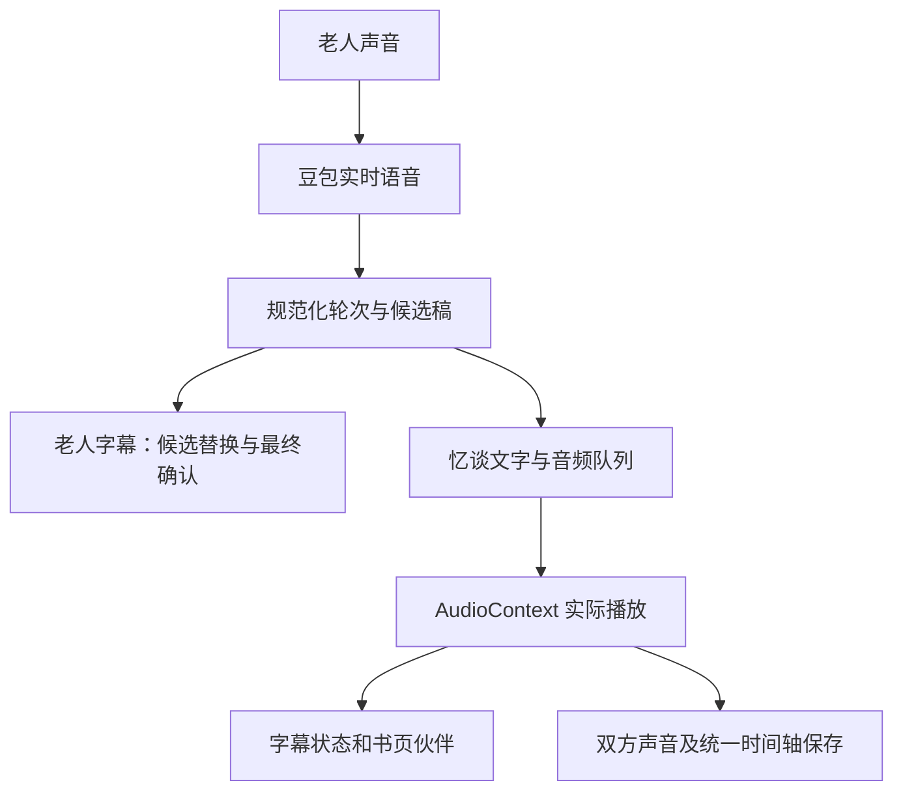

# 通话实时字幕与二维书页伙伴

更新：2026-11-12。手机通话已接入实时对话文字和二维书页伙伴。

字幕复用同一通豆包语音返回的文字，书页伙伴在浏览器本地根据实际播放总线音量开合嘴部。没有新增模型调用或付费云服务，原有通话用量继续计费。

通话保存频率、任务续租及十二小时恢复巡查保持现有设置。播放开始按实际段落记录，音频分片仍分别保存调度及正常结束回报。字幕状态复用现有加密时间轴保存；有限协议诊断每种事件最多八条、合计最多一百二十八条，仅保存顺序、字段形状、文字长度和标识哈希。

## 通话中的交互

1. 区分“您”和“忆谈”。老人听写按同一轮候选稿替换，结束后确认；不同轮次的相同文字分别保留。
2. 默认显示最近两条，可选择大字和完整对话。向上阅读历史时停止跟随，点击“回到最新一句”继续跟随。
3. 忆谈文字等对应声音实际开始后显示。供应商真实 TTS 文字及模型、开场参考稿分别处理，参考稿明确显示“参考文字，以实际听到的声音为准”。只有真实 TTS 文字对应的音频全部正常结束并收到合成结束，才显示“已说完”；参考文字仅标“发言已结束”。
4. 被打断的发言显示“已打断”，尚未开始播放的内容保持隐藏。迟到的旧取消确认不会停止新轮次。声音暂停按 AudioContext 实际时钟冻结；断线、暂停和保存状态直接显示。
5. 二维书页伙伴明确标注“AI 访谈者”。嘴部由实际播放音量驱动，声音暂停、数字静音、页面隐藏和减少动态时停止。系统音量键及外部扬声器静音无法由网页音量分析判断。
6. 老人原声、AI 原始声音及统一时间轴录音继续保存。正式成书使用完整录音转写，现场文字可能有听写误差。字幕出站和保存使用既有银行卡号脱敏规则。

实现位置：`backend/app/services/realtime_captions.py` 负责轮次和文字来源；`doubao.py` 接收真实事件；本机与云端接口兼容转发。`frontend/lib/call-playback.ts` 管理实际播放和打断，`call-captions.ts` 管理字幕状态；`call-panel.tsx`、`call-transcript.tsx`、`interviewer-avatar.tsx` 提供手机界面。

## 已运行的验证

一次真实豆包会话中，将同一已授权的 7.977625 秒录音播放两次，三十三项检查通过。发生两次真实打断、211 次 ASR 候选和两个最终轮次，相同文字分别保留。三条保存音轨与实际收发 PCM 逐字节一致，混合录音包含暂停间隔。实际音量驱动、暂停及数字静音闭嘴、减少动态、结束保存和资源关闭均通过。

三次原始 `response.output_audio.started` 均没有 TTS 文字字段，界面实际使用带说明的参考文字。前两轮保留打断状态，末轮通过十一条实际结束回报确认播放结束；供应商真实 TTS 文字对应的“已说完”分支未在这次会话触发。

另有四项真实通话页面检查通过：320、390、430px 在初始及权限失败状态均无横向溢出，点击区域至少 44px；未同意录音和浏览器原生拒绝麦克风时均未创建通话，AudioContext 关闭，头像静止。该检查没有模型调用。

录音验证复用生产播放、字幕与头像模块及真实供应商，明确不覆盖现场麦克风、完整通话页面操作及真实手机系统后台行为。迟到旧轮和供应商错误未在这次真实会话自然发生，未作为已覆盖项目。受保护记录在本机 `.intermediate/replay-voice-check/` 与 `.intermediate/call-ui-check/`，不进入仓库。

## 依据

- [豆包实时语音协议](https://docs.volcengine.com/docs/doubao-voice/end-to-end-real-time-voice-full-duplex-version?lang=zh)：实时输入转写、输出文字与音频事件。
- [Web Audio AnalyserNode](https://www.w3.org/TR/webaudio/#AnalyserNode)：浏览器中的实时音频分析。
