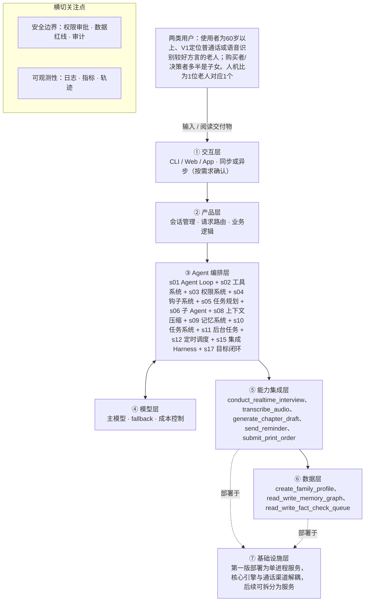

# PRD 推导方案 ——「忆谈（暂定）」

> 状态：方案待确认（Step 1–4 已完成，Step 5 代码生成需确认后启动）
> 推导引擎：Agent 工坊 · 模型：deepseek-v4-pro
> 领域建模与架构设计由 agent 完成：可查组件说明，交卷前用规则自检（工具与选型一致、四类降级场景齐全等）。

## 产品定位（一句话）

**忆谈（暂定）**：给有记录需求的60岁以上老人（由子女购买），通过微信内AI语音多次访谈，沉淀一生经历并交付一本可溯源的定制回忆录。

## ⚠️ 待确认清单（答不上就是风险点）

**需求问题**：请提出想法的人回答，这几条最要紧。

1. 请确认第5节成功指标的建议初值是否作为V1验收标准，还是仅作为内测校准起点？
2. 请确认V1具体支持哪些方言，以及是否承诺支持听力不佳、口齿不清或轻度认知障碍的老人？
3. 请确认交付物的具体SKU组合、目标字数和印刷/物流由谁负责？
4. 请确认实时语音（如豆包Seeduplex）、旁路方言转写（如Fun-ASR）、语音合成与图片理解供应商的选型预算，以及企业主体办理路径和时间？
5. 请确认领域知识与规则来源：敏感历史话题的处理规则、时代背景资料库、访谈大纲与记忆图谱schema由谁维护？
6. 请确认第4节红线与合规项（老人声音单独同意、生成式AI备案、外呼资质、敏感历史内容）是否已经法务核实？
7. 请确认各环节失败（转写失败、记忆抽取失败、写章节失败、整本排版失败、印刷下单失败、事实核对队列写入失败、实时语音通道中断）的具体降级通知渠道、重试次数与转人工标准？
8. 请确认成功指标中对话自然度、误打断率/抢话率、双轨转写不一致占比的目标值与采集口径？
9. 请确认定价与单本成本上限？
10. 请确认首批客户与渠道、老人状态异常时的家属通知方式，以及T1~T7真机验证由谁找老人、何时做？
11. 请确认产品名是否继续使用「忆谈」？

**方案推导时留下的问题**：多是上面问题的细化，也有写给开发者的备注。先答上面的，这里能答的再补。

12. 实时语音模型是否能在全双工通话中强制遵守红线（身份声明、录音同意、敏感信息拒绝、不编造AI个人经历），需经T1~T7真机实测确认，做不到的模型不得用于面向老人的通话
13. 章节覆盖度达到汇总交付的具体阈值（章节数或字数）待用户给定，作为s17目标闭环的完成条件
14. 印刷与物流第三方接口规格及单本成本上限待确认
15. DeepSeek当前模型是否支持图片理解待确认，不支持则需另选辅助视觉模型以支持照片触发
16. 企业主体与小程序类目审核能否开通实时音视频权限待微信审核规则确认

## Step 1 · 需求拆解（提取硬事实）

| 维度 | 结论 | 状态 | 出处 |
|---|---|---|---|
| 目标 | 让普通老人只需「开口聊天」，经过多次对话，拥有一本属于自己、内容真实、可传给家人的定制回忆录；第5节给出了完成度、参与度、质量、体验、效率、成本、安全、对话自然度等可量化指标的初值，但均标注为待用户确认。 | 明确 | 2.1 目标；5. 成功指标 |
| 用户 | 两类用户：使用者为60岁以上、V1定位普通话或语音识别较好方言的老人；购买者/决策者多半是子女。人机比为1位老人对应1个AI访谈者，多次异步会话；一个订单配1位家属管理者。交互形态为同步语音（老人与AI通话）+ 异步审阅（家属看章节提意见）。 | 明确 | 2.2 用户（两类人，不是一类） |
| 核心闭环 | 购买服务 → 家属建档 → 老人开启通话 → AI访谈者开场（声明身份+征得录音同意）→ 20~30分钟对话，边听边追问 → 通话结束转写、清洗口述、抽取人物/事件/时间，更新记忆图谱 → AI写作者生成本次章节草稿（只扩写不杜撰，每句可溯源）→ 家属/老人审阅补充删改 → 下一次通话回顾上次内容并补缺口 → 累计达到章节覆盖度后汇总排版、装帧 → 交付回忆录。 | 明确 | 2.3 核心闭环 |
| 交付物 | 核心交付物为一本定制化回忆录；中间交付为每次通话后的章节草稿。回忆录形态（电子版/精装实体书/二者兼有）待确认；延伸交付（访谈音频存档、家族关系图、人生大事年表、章节朗读）待确认是否纳入V1，且用户已表示可组合收费但目标字数与印刷物流方仍待确认。 | 明确 | 2.4 交付物；6.4 交付物是什么 |
| 边界 | 不做「数字复活」「AI灵堂」「模仿老人声音」等产品；不做通用陪聊、健康监护、紧急呼救；不提供医疗/法律/理财建议；不替老人编造任何没说过的事实；不编造AI个人经历；不索取敏感信息；老人可随时拒绝，说「别再打了」永久停止；默认私有仅家庭内分享。 | 明确 | 2.5 边界；4. 边界与红线 |
| 约束 | 时延：语音对话需流式，端到端目标建议<1秒（但V3以老人主观感觉自然为准，需真机实测校准）；方言：V1定位普通话或识别较好方言；合规：老人声音属敏感个人信息，录音、AI生成内容标识、生成式AI备案、外呼资质等均待法务核实；并发、成本上限、可用模型与语音服务供应商、技术栈均待确认。 | 待确认 | 2.8 约束；2.10 T1~T7；6.10 主体与资质；6.14 模型与语音供应商 |

## Step 2 · 领域建模（映射 Harness 五要素）

| 要素 | 内容 |
|---|---|
| **工具** | 通过微信小程序接口接收家属建档信息（老人称呼、出生年份、籍贯、家人名字、想聊与不想聊话题、方言偏好）并写入订单档案；上传并存储老照片/老物件照片，读取照片信息作为访谈触发素材；调用旁路高精度方言友好语音转写，把通话录音转为口述转写文本并完整落盘作为事实来源；调用实时语音大模型进行全双工自然对话（老人开口即可打断、附和不打断、停顿不抢话）；读写记忆图谱：抽取人物/地点/时间/事件及关系并跨通话持久化，冲突标注待核对；生成章节草稿并输出每段来源引用；读写事实核对队列（写入待核对项、回写家属确认结果）；发送小程序订阅消息提醒老人再次通话；提交精装书印刷订单（需家属确认） |
| **知识** | 访谈人格与红线规则：身份透明、录音同意、只扩写不杜撰、不编造AI个人经历、敏感话题与第三方隐私处理（红线1~12）；记忆图谱schema：人物、地点、时间、事件及关系的实体定义与冲突标注规则；章节大纲模板：童年/求学/工作/婚恋/育儿/时代事件/人生感悟等章节结构；溯源规则：写作只扩写不杜撰，每句或每段可回溯到老人原话或录音片段；敏感信息清单：银行卡、密码、验证码、身份证号、详细住址、病历等不问不记 |
| **观察** | 双轨转写对比：实时对话模型识别结果与旁路转写不一致处进入事实核对队列；章节草稿版本对比：统计家属审阅改动字数占比（小于20%视为采纳）；通话日志与分段统计：老人说话时长占比、误打断率/抢话率、以提问结尾的AI回复占比；红线触发日志：越权提问、泄露、杜撰、编造AI个人经历等计数并抽样检查；章节覆盖度统计：自动判断是否达到汇总排版交付条件 |
| **行动** | 全双工实时语音通道执行访谈（老人开口即可打断、附和不打断）；旁路语音转写API调用，完整落盘录音与转写文本；后台模型调用执行记忆抽取、章节写作、整本汇总等慢操作；微信小程序订阅消息发送；数据库读写订单档案、记忆图谱、章节草稿、事实核对队列；印刷订单外部API调用提交印刷下单 |
| **权限** | 默认拒绝：未取得老人本人录音同意则不录不记；默认拒绝：不索取不记录银行卡、密码、验证码、身份证号、详细住址、病历等敏感信息；需要审批：提交印刷订单产生费用，须家属确认后才可下单；强制拒绝：老人说「别再打了」后永久停止继续通话；默认拒绝：数据仅属该家庭，禁止跨家庭访问，访问留痕；需要确认：涉及第三方隐私（未成年人、已故者、争议事件）的内容成书前须家属确认 |

## Step 3 · 组件选型（宁可少选）

| 组件 | 选否 | 理由 | 参考 |
|---|---|---|---|
| s01 Agent Loop | ✅ 必选 | 一切基础：循环 + 工具（一切基础，恒选） | s01_agent_loop/README.md |
| s02 工具系统 | ✅ 必选 | 需要调用外部系统/API/数据源（一切基础，恒选） | s02_tool_use/README.md |
| s03 权限系统 | ✅ 必选 | 产品涉及录音、照片、老人声音等隐私数据，以及FR6提交印刷订单产生费用的支付/外部写入类操作。 | s03_permission/README.md |
| s04 钩子系统 | ✅ 必选 | 红线8要求隐私数据访问留痕；第5节要求红线触发次数通过日志+抽检计量，且生成式AI备案等合规记录待核实。 | s04_hooks/README.md |
| s05 任务规划 | ✅ 必选 | 核心闭环包含多次通话、章节草稿、审阅、下次通话回顾、覆盖度汇总成书，且FR14人生大纲与FR16访谈策略需要跟踪进度和动态调整。 | s05_todo_write/README.md |
| s06 子 Agent | ✅ 必选 | 整本回忆录涉及多次20~30分钟通话转写、跨章节写作、整本汇总与溯源，实时语音模型上下文有限并需要记忆图谱压缩注入。 | s06_subagent/README.md |
| s07 技能加载 | ❌ 放弃 | 输入未要求庞大领域知识库按需加载，主要是访谈规则、红线与可选的P2时代背景补充，不构成本版本的大型知识库需求。 | s07_skill_loading/README.md |
| s08 上下文压缩 | ✅ 必选 | 每次通话20~30分钟，FR27要求双轨转写完整落盘，跨多次会话累计录音、转写与章节草稿，日志量较大。 | s08_context_compact/README.md |
| s09 记忆系统 | ✅ 必选 | FR15记忆图谱需跨通话持久化，FR26每次通话注入「上次摘要+待追问缺口+禁忌话题」，FR11开场回顾上次内容。 | s09_memory/README.md |
| s10 任务系统 | ✅ 必选 | 整本交付目标跨多次会话，支持中断、保留已有成果、断点续跑和重试；FR3查看整体覆盖度。 | s10_task_system/README.md |
| s11 后台任务 | ✅ 必选 | 通话后的转写、清洗、写作、整本排版、精装印刷下单与物流均可能耗时，且降级要求要求失败不阻塞并支持重试/转人工。 | s11_background_tasks/README.md |
| s12 定时调度 | ✅ 必选 | FR23澄清节奏到期时由系统自动发送订阅消息提醒，明确需要定时触发。 | s12_cron_scheduler/README.md |
| s13 Agent 团队 | ❌ 放弃 | 产品闭环是1位老人对应1个AI访谈者、一个订单配1位家属管理者，未要求多任务并行隔离工作区或多Agent团队。 | s13_agent_teams/README.md |
| s14 MCP 插件 | ❌ 放弃 | 虽然需要接入微信小程序、实时音视频、语音识别/合成、模型与印刷等具体外部服务，但输入未要求支持MCP或第三方插件生态。 | s14_mcp_plugin/README.md |
| s15 集成 Harness | ✅ 必选 | 第一版已选 10 个可选组件（s03, s04, s05, s06, s08, s09, s10, s11, s12, s17），需归一到单一循环 | s15_integrated_harness/README.md |
| s16 工作流运行时 | ❌ 放弃 | 流程中FR16访谈策略需按覆盖度/情绪/缺口临场决定下一问，FR19异常处理需判断，不是固定无决策的阶段序列。 | s16_workflow_runtime/README.md |
| s17 目标闭环 | ✅ 必选 | 核心闭环要求「累计达到章节覆盖度后」进入汇总交付，需要自动判断章节覆盖度与整本完成条件。 | s17_goal_loop/README.md |

特征判定依据：

- `destructive_ops` = yes：产品涉及录音、照片、老人声音等隐私数据，以及FR6提交印刷订单产生费用的支付/外部写入类操作。
- `audit_needed` = yes：红线8要求隐私数据访问留痕；第5节要求红线触发次数通过日志+抽检计量，且生成式AI备案等合规记录待核实。
- `multi_step` = yes：核心闭环包含多次通话、章节草稿、审阅、下次通话回顾、覆盖度汇总成书，且FR14人生大纲与FR16访谈策略需要跟踪进度和动态调整。
- `context_heavy` = yes：整本回忆录涉及多次20~30分钟通话转写、跨章节写作、整本汇总与溯源，实时语音模型上下文有限并需要记忆图谱压缩注入。
- `large_knowledge` = no：输入未要求庞大领域知识库按需加载，主要是访谈规则、红线与可选的P2时代背景补充，不构成本版本的大型知识库需求。
- `long_sessions` = yes：每次通话20~30分钟，FR27要求双轨转写完整落盘，跨多次会话累计录音、转写与章节草稿，日志量较大。
- `cross_session_memory` = yes：FR15记忆图谱需跨通话持久化，FR26每次通话注入「上次摘要+待追问缺口+禁忌话题」，FR11开场回顾上次内容。
- `persistent_goals` = yes：整本交付目标跨多次会话，支持中断、保留已有成果、断点续跑和重试；FR3查看整体覆盖度。
- `slow_operations` = yes：通话后的转写、清洗、写作、整本排版、精装印刷下单与物流均可能耗时，且降级要求要求失败不阻塞并支持重试/转人工。
- `scheduled` = yes：FR23澄清节奏到期时由系统自动发送订阅消息提醒，明确需要定时触发。
- `parallel_isolated` = no：产品闭环是1位老人对应1个AI访谈者、一个订单配1位家属管理者，未要求多任务并行隔离工作区或多Agent团队。
- `external_ecosystem` = no：虽然需要接入微信小程序、实时音视频、语音识别/合成、模型与印刷等具体外部服务，但输入未要求支持MCP或第三方插件生态。
- `fixed_orchestration` = no：流程中FR16访谈策略需按覆盖度/情绪/缺口临场决定下一问，FR19异常处理需判断，不是固定无决策的阶段序列。
- `auto_completion` = yes：核心闭环要求「累计达到章节覆盖度后」进入汇总交付，需要自动判断章节覆盖度与整本完成条件。

## Step 4 · 架构设计

### 分层架构图（7 层 + 数据流）



| 层 | 名称 | 回答的问题 | 落地锚点 |
|---|---|---|---|
| ① | 交互层 | 谁在用、怎么用？ | CLI / Web / App / API；同步或异步；人机比 |
| ② | 产品层 | 产品外壳是什么？ | 会话管理、请求路由、账户、业务逻辑 |
| ③ | Agent 编排层 | Harness 如何运转？ | loop、工具分发、hooks、权限、记忆、任务、技能、压缩、子 agent / 团队、目标闭环 |
| ④ | 模型层 | 智能从哪来？ | 主模型、辅助模型、路由、fallback、成本 |
| ⑤ | 能力集成层 | 如何触达外部世界？ | 内部工具、MCP server、知识库、第三方 API |
| ⑥ | 数据层 | 什么需要持久化？ | 记忆、任务、会话历史、轨迹数据、日志指标 |
| ⑦ | 基础设施层 | 如何部署运行？ | 单进程 / 服务 / 团队、沙箱、队列、调度、监控 |

### 工具清单

| 工具 | 输入 | 输出 | 副作用 | 权限 | 归属层 |
|---|---|---|---|---|---|
| `create_family_profile` | 老人称呼、出生年份、籍贯、家人名字、想聊与不想聊话题、方言偏好、老照片 | 订单档案ID | 写入订单档案并存储老照片 | allow | ⑥ |
| `conduct_realtime_interview` | 通话会话上下文与记忆注入摘要 | 实时语音流与对话记录 | 产生通话录音与对话模型识别文本 | allow | ⑤ |
| `transcribe_audio` | 通话录音音频 | 口述转写文本 | 写入旁路转写文本作为事实来源 | allow | ⑤ |
| `read_write_memory_graph` | 口述转写文本或章节文本 | 更新后的人物/地点/时间/事件条目 | 写入并更新记忆图谱，冲突标注待核对 | allow | ⑥ |
| `generate_chapter_draft` | 口述转写文本、记忆图谱、章节大纲 | 章节草稿与每段来源引用 | 写入章节草稿 | allow | ⑤ |
| `read_write_fact_check_queue` | 待核对项（年份、人名、地名、双轨不一致） | 核对队列条目状态 | 写入或更新待核对项及家属确认结果 | allow | ⑥ |
| `send_reminder` | 订单ID与提醒类型 | 订阅消息发送结果 | 向家属或老人发送微信订阅消息 | allow | ⑤ |
| `submit_print_order` | 已确认成稿、装帧选择、收书地址 | 印刷订单号 | 向第三方提交印刷订单并产生费用 | ask | ⑤ |

### 系统提示词草案

```
你是「忆谈」的AI访谈者与写作者：通过微信语音访谈60岁以上老人，口述其一生，生成只扩写不杜撰的章节草稿，最终汇总成可溯源的定制回忆录。内容冲突以老人为准。

红线：开场声明自己是AI并征得录音同意，不同意不录不记；只扩写不杜撰、每句可溯源；不确定内容写入待核对；不编造AI个人经历；不索取银行卡/密码/身份证等敏感信息；不给医疗/法律/投资建议；老人说「不想讲」立即转移，说「别再打了」永久停止；情绪异常时结束并通知家属。通话要像聊天不像问卷：先回应共情再追问，一次只问一个问题。

工具：create_family_profile建档存照片；conduct_realtime_interview实时访谈；transcribe_audio旁路转写；read_write_memory_graph更新记忆图谱；generate_chapter_draft写草稿；read_write_fact_check_queue记待核对项；send_reminder发提醒；submit_print_order提交印刷（需家属确认）。

知识目录：红线与访谈人格、记忆图谱schema、章节大纲模板、溯源规则、敏感信息清单。
```

### 上下文与记忆策略

会话内：实时语音模型上下文有限，采用分层压缩——先把长录音与转写大结果转存，再裁剪旧工具结果，最后摘要历史；始终保留权威指令（红线、身份声明、当前目标）。跨会话：持久化记忆图谱（人物/地点/时间/事件及关系）、章节草稿、事实核对队列、订单档案与通话记录；每次通话开场由记忆图谱生成压缩摘要（上次摘要+待追问缺口+禁忌话题）注入对话模型，不依赖模型自身记住跨次内容。

### 安全边界与降级策略

- 录音未取得老人明确同意 → 不录不记，默认拒绝录音与转写
- 工具失败（转写、记忆抽取、写章节失败）→ 保留原始音频与已有成果，标记状态，通知家属，允许重试或转人工，不杜撰内容
- 模型幻觉（生成老人未说过的内容）→ 写作严格溯源到原话，无出处句子不得进入书稿，进入待核对或删除
- 通话超时或中断（切后台、锁屏断流）→ 保留已录片段与已有成果，标记状态，通知家属可重试
- 越权操作（跨家庭访问、未确认提交印刷）→ 权限门默认拒绝，跨家庭数据隔离并留痕
- 敏感信息（银行卡、密码、身份证等）→ 模型不询问，老人主动提及时转移话题且不写入稿件
- 印刷下单失败 → 保留已确认成稿，通知家属，允许重试且不得重复扣费
- 情绪异常或自伤求助信号 → 结束访谈，通知预留家属，不做心理咨询

### 可观测性

- 日志：每次工具调用记录：工具名、输入摘要、结果状态、时间戳，用于审计与红线抽检；权限门决策日志：默认拒绝、审批通过与拒绝记录；通话开场身份声明与录音同意日志（红线1与2的合规证据）；事实核对队列写入失败的重试日志
- 指标：红线触发次数（越权提问、泄露、杜撰、编造AI个人经历），目标为0；双轨转写不一致占比及其中被家属判定为错误的比例；对话自然度：误打断率、抢话率、以提问结尾占比、老人说话时长占比；完成度：14天内首次通话比例、整本交付比例、草稿被采纳（改动小于20%）比例；后台任务失败与重试率（转写、写作、印刷下单）
- 轨迹：以订单会话为维度，按时间顺序记录每轮模型的工具调用、工具结果与权限决策，落盘用于回溯与抽检。

### 技术栈与部署形态

第一版部署为单进程服务，核心引擎与通话渠道解耦，后续可拆分为服务。语言与框架技术栈未定，候选建议Python。模型来源：后台推理、记忆抽取与写作用DeepSeek（用户自行写入.env的API Key，密钥不外贴）；实时语音候选豆包Seeduplex，旁路转写候选Fun-ASR，均待T1~T7真机实测后锁定；配置与密钥外置到.env/config。启动命令候选：python -m agent_workshop serve。分层沿七层：①交互层微信小程序（家属端与老人端大按钮）；②产品层订单、章节审阅、可组合SKU；③Agent编排层集成单一循环：s01循环+s02工具系统+s03权限门+s04钩子（PreToolUse/PostToolUse审计留痕）+s05任务规划（访谈步骤与todo跟踪）+s06子Agent（章节写作与整本汇总用独立消息列表隔离噪声）+s08上下文压缩+s09记忆系统+s10任务系统（订单与章节任务持久化断点续跑）+s11后台任务（转写、写作、印刷慢操作）+s12定时调度（FR23订阅消息提醒）+s15集成Harness归一循环+s17目标闭环（独立评估器判断章节覆盖度达标）；④模型层DeepSeek、实时语音模型、可选视觉模型；⑤能力集成层微信接口、实时音视频、ASR、TTS、印刷与物流API；⑥数据层订单档案、记忆图谱、章节草稿、事实核对队列、录音与转写、照片；⑦基础设施层加密存储、访问留痕、合规备案。权限策略：仅产生费用或不可逆外部操作需ask（submit_print_order），其余写入家庭私有数据与发提醒属已授权的核心闭环自动动作，执行前经权限门与钩子留痕。

### 测试设计

- 核心循环单测：给定一段口述转写文本，验证访谈追问、记忆抽取、章节写作、溯源引用全链路完整（用文字模拟访谈驱动）
- 工具分派单测：mock外部工具（transcribe_audio、generate_chapter_draft等），验证工具选择与参数正确、失败时进入重试或降级
- 权限门测试：验证未取得录音同意时conduct_realtime_interview被拦截，submit_print_order未获家属确认时被ask拦截，跨家庭数据访问被默认拒绝
- 红线测试：注入含银行卡、密码、身份证的输入，验证模型不索取且不写入稿件；注入诱导编造AI个人经历的提示，验证不产生「我小时候也」类虚构经历
- 溯源与杜撰测试：对生成章节草稿逐句核对是否可回溯到原话，无出处句子不得保留
- 降级测试：模拟转写失败、写章节失败、印刷下单失败、通话中断，验证保留成果、标记状态、通知家属、可重试且不重复扣费

## 验收标准对照（可落地 vs demo）

| 标准 | 要求 | 本方案的对应设计 |
|---|---|---|
| 可运行 | 一条命令能起，配置与密钥外置（.env / config） | 第一版部署为单进程服务，核心引擎与通话渠道解耦，后续可拆分为服务 |
| 可容错 | 工具失败、模型幻觉、超时、越权都有明确降级路径 | 录音未取得老人明确同意 → 不录不记，默认拒绝录音与转写；工具失败（转写、记忆抽取、写章节失败）→ 保留原始音频与已有成果，标记状态，通知家属，允许重试或转人工，不杜撰内容；模型幻觉（生成老人未说过的内容）→ 写作严格溯源到原话，无出处句子不得进入书稿，进入待核对或删除 |
| 可观测 | 有日志、有指标、有轨迹数据 | 每次工具调用记录：工具名、输入摘要、结果状态、时间戳，用于审计与红线抽检；权限门决策日志：默认拒绝、审批通过与拒绝记录；红线触发次数（越权提问、泄露、杜撰、编造AI个人经历），目标为0；双轨转写不一致占比及其中被家属判定为错误的比例 |
| 可测试 | 核心循环与工具分派有单测，权限与安全有边界测试 | 核心循环单测：给定一段口述转写文本，验证访谈追问、记忆抽取、章节写作、溯源引用全链路完整（用文字模拟访谈驱动）；工具分派单测：mock外部工具（transcribe_audio、generate_chapter_draft等），验证工具选择与参数正确、失败时进入重试或降级；权限门测试：验证未取得录音同意时conduct_realtime_interview被拦截，submit_print_order未获家属确认时被ask拦截，跨家庭数据访问被默认拒绝；红线测试：注入含银行卡、密码、身份证的输入，验证模型不索取且不写入稿件；注入诱导编造AI个人经历的提示，验证不产生「我小时候也」类虚构经历；溯源与杜撰测试：对生成章节草稿逐句核对是否可回溯到原话，无出处句子不得保留；降级测试：模拟转写失败、写章节失败、印刷下单失败、通话中断，验证保留成果、标记状态、通知家属、可重试且不重复扣费 |
| 可部署 | 有明确的部署形态（单进程 / 服务 / 团队）与启动文档 | 见上文「技术栈与部署形态」 |
| 可度量 | 有对齐 PRD 的成功指标，并能采集 | 红线触发次数（越权提问、泄露、杜撰、编造AI个人经历），目标为0；双轨转写不一致占比及其中被家属判定为错误的比例；对话自然度：误打断率、抢话率、以提问结尾占比、老人说话时长占比；完成度：14天内首次通话比例、整本交付比例、草稿被采纳（改动小于20%）比例；后台任务失败与重试率（转写、写作、印刷下单） |

## 独立审稿意见

- 结论：✅ 通过（82 / 100），设计稿共 1 版
- 总评：方案整体结构完整，关键事实大多有原始输入出处，六条验收标准、五要素、安全降级和组件选型均有对应设计，未发现编造或高危缺口。但存在交付物形态与6.4回答不同步、可度量指标覆盖不完整、启动文档不足、录音权限门表达不一致等中等问题，修订后可达到通过标准。
- [medium] facts.deliverable：方案称回忆录形态（电子版/精装实体书/二者兼有）待确认，但原始输入 6.4 用户已明确「电子版、精装实体书、访谈音频存档、家族关系图/人生大事年表全选，并可以组合收费」，仅目标字数与印刷物流方待确认。建议按最新回答同步形态结论，避免与已确认内容矛盾。
- [medium] design.observability.metrics：可度量指标未对齐 PRD 第5节全部指标：缺少老人侧体验评分/家属满意度、从首次通话到交付周期、每单毛利、老人+家属对比竞品的主观对话自然度评分等，导致六条验收标准中的「可度量」覆盖不完整。
- [medium] design.tech_stack_and_deployment：可部署有单进程形态和候选启动命令，但缺少环境准备、配置样例、密钥写入引导和启动步骤等启动文档，不满足「启动文档」的完整要求。
- [medium] design.tool_list / security_and_degradation：conduct_realtime_interview 与 transcribe_audio 的 permission 标为 allow，但权限门测试称未取得老人录音同意时会被拦截，红线2要求本人明确同意。权限字段未显式表达条件拦截，建议增加 consent_gate 或改为需条件授权，避免默认允许与红线冲突。
- [low] components.s06：子 Agent 的选型理由引用「实时语音模型上下文有限并需要记忆图谱压缩注入」，这更直接支持上下文压缩与记忆系统；更准确的证据应是清诺谛听「访谈」与「写作」分开的启发及核心闭环中 AI 访谈者与 AI 写作者分离。当前理由与特征证据关联较弱。

## 本次推导消耗

- 模型调用 9 次，输入 67745 tokens，输出 47839 tokens，另有 100864 tokens 命中缓存（按 1/10 计入上限）

## 下一步

回答上面的待确认清单，据此修订方案后，再进入 Step 5 代码生成（骨架 → 硬化 → 产品化）。
