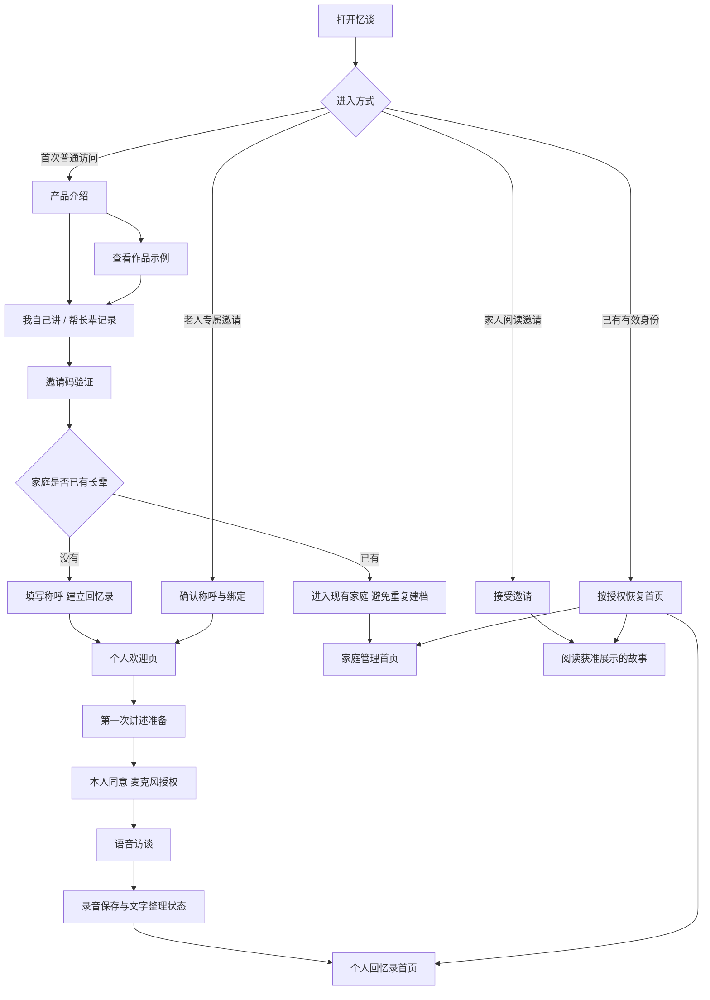

# 首次进入与家庭引导设计方案

日期：2026-11-10。状态：Figma 手机设计已接入产品的品牌、引导、登录建档、家属交接与统一书封。入口按有效会话与授权档案恢复设备选择。文档中讲述者专属绑定、家庭用途分类和计费服务仍为后续设计，当前继续执行既有后台权限。

Figma 文件：https://www.figma.com/design/ItHDGIIZGO2KLM24jMYr3Z 。13 个 390×844 画面，包含品牌首页、本人及家属路径、回忆卡展开与体验后的服务入口。文案、书封和按钮均为可编辑图层；已检查边界及跳转目标。按照项目规则未主动使用截图视觉检查。原型不执行登录、录音、模型生成或支付。

## 1. 现有入口与设计目标

当前 `/` 展示书封和邀请码；登录成功固定跳转 `/profiles`，列出账户中的所有老人。个人首页的品牌按钮也返回这个列表。建档表单同时展示称呼、出生年份、家乡、家人和话题等六项内容。现有家人邀请有独立阅读身份，老人使用仍共用管理者身份。

本次设计以一个家庭通常有 1—2 位长辈、最多 4 位长辈为基础。每位长辈拥有自己的回忆录、照片、访谈与讲述入口。老人再次进入时，直接回到自己的故事。管理家属可以查看与管理家庭内的长辈。受邀家人阅读获准展示的内容。

首次使用需要回答四件事：忆谈能留下什么、怎么开始、故事给谁看、下次怎么回来。主要引导采用三个连续交互画面，每次操作直接展示相关结果。其他说明放在可展开的详情中；引导随时可退出，也可以从“我的”重新查看。

### 首次体验的三个连续画面

| 画面 | 用户做什么 | 页面呈现的结果 | 主要按钮 |
| --- | --- | --- | --- |
| 打开一张回忆卡 | 点击一张关于童年的卡片 | 卡片展开，出现“小时候家住在哪里”等具体问题，让用户知道讲述从何开始 | 讲完之后，会得到什么？ |
| 一段讲述，成为一页回忆 | 点击播放获准展示的真实原声，再点击查看整理结果；也可直接阅读 | 同一份示例的原话与成稿书页，持续标注示例及人物归属 | 看看家人怎么读 |
| 一本回忆录，留给在乎的人 | 点击预览家人看到的页面 | 展示书页、原声及留言入口的用途，说明展示内容由用户决定，原声单独授权 | 开始自己的回忆录 |

顶部提供返回、当前步骤“1/3”等标记及“直接开始”。不强制播放音频、等待动画或完成所有画面。最后一个按钮进入为谁记录、邀请码验证及最少信息建档；保存前说明将创建哪一本书。介绍画面只保存选择进度，不创建档案，也不启动模型任务。

书封属于版式预览；原声与书页属于获准展示的示例；家人阅读属于功能预览。预览不制造阅读人数和留言，不把示例经历写入用户的书。真实素材尚无公开展示授权时，第二个画面使用书页结构与流程说明，受保护账户仍可查看已授权范围内的真实材料。

选择“妈妈”用于引导文案，正式建档时确认老人本人使用的称呼，例如“王阿姨”。建档结束后进入本人欢迎页和首次讲述准备。老人专属邀请与家人阅读邀请直接进入各自流程。登录后保留原有选择、站内目标和步骤，返回地址由后台校验。

参考来源为用户提供的 Cave Couples。已通过 Chrome 无痕窗口按新用户路径访问：首页 → Try on web → 对话示例 → 刮开并翻转任务卡 → 记忆与每周故事示例 → 注册 → 付费页。画布刮动与注册由产品经理操作，其他导航及结果由 Agent 实际读取验证。未购买。详细记录见 `docs/设计参考/Cave Couples新用户体验记录.md`。

### 付费出现的时机

产品经理确认付费安排在体验之后。引导、建档、第一次讲述及首次成稿查看保持连续。成稿页先支持阅读和回听，再提供“了解后续记录服务”的次要入口，不自动弹出购买页面。具体价格、体验额度和付费权益仍待业务确认，Figma 当前只展示入口位置，不模拟购买，不使用未确定的免费或价格承诺。

## 2. 入口与导航

| 使用身份 | 默认首页 | 底部导航 | 主要权限 |
| --- | --- | --- | --- |
| 讲述者 | 自己的回忆录 | 我的故事、家人、我的 | 讲述、看自己的正文与照片、听自己的录音、查看家人留言 |
| 管理家属 | 我们家的故事 | 家庭、家人、我的 | 建档、准备照片、审阅、处理重要核对项、邀请和管理展示范围 |
| 受邀阅读者 | 获邀阅读的回忆录 | 故事、留言、我的 | 阅读获准展示的正文和照片；获准时收听原声 |

“我自己讲”“帮长辈记录”表达本次使用目的。权限由登录身份及后台授权决定，点击角色卡片不能取得管理权限。老人自行创建自己的档案时，同时拥有本人书籍的管理权；普通操作使用讲述者首页，管理功能集中在“我的”。

邀请访问直接处理邀请；有效身份直接进入对应首页。系统加载期间不显示其他人的书籍，也不短暂显示空家庭。登录过期后保留站内目标，验证成功并确认权限后回到原页面。

## 3. 首次进入的页面

### 3.1 产品介绍页

首次普通访问进入三个连续交互画面。“了解更多”展开以下四个内容区域，底部提供“开始记录”，另有“已有家庭，进入”。

1. **为什么留下来**：标题“把您走过的日子，留给家人”。画面使用一本回忆录与生活照片的构图；说明“和 AI 采访者聊聊往事，慢慢整理成自己的回忆录”。
2. **最后得到什么**：三张可点击的小卡片，分别展示“一篇写好的故事”“留下当时的声音”“给家人阅读和留言”。
3. **怎么使用**：讲一段往事 → 整理成文字 → 看过后给家人阅读。说明可以分多次讲，想停就停。
4. **故事由谁看**：明确家庭授权规则；说明当前需要连接同一 Wi-Fi、运行忆谈的电脑保持开启。隐私详情入口解释录音保存及国内语音、转写和写作服务处理。

介绍页不自动播放音视频。已经登录的人从“我的 → 了解忆谈”可以再次打开，返回时保留原来的书籍和阅读位置。宣传内容只呈现已经提供的功能，价格、实体印刷、动画服务等未确认内容不作为承诺。

### 3.2 作品示例页

展示一份已获展示授权的真实材料节选，包含“讲述原声”和“整理后的文章”，通过明确按钮切换或播放。文字始终标注“作品示例”。底部显示“也为自己或家人留一本”。

李奶奶现有材料可以用于当前管理账户内的效果预览；进入未登录的公开介绍页前，需要核实素材展示授权。授权未明确时，公开页面展示功能说明与书页排版，完整真实语料继续留在受保护的管理入口。

阅读示例不创建个人档案、不计入家庭人数、不自动复制进用户的书。示例阅读位置与个人阅读位置分别保存。

### 3.3 使用目的页

两个纵向大按钮：

- “记录我的经历”：说明“从您自己的故事开始”。
- “帮长辈留下故事”：说明“准备好回忆录，再陪长辈讲一讲”。

下方保留“家人已经帮我准备好了”入口，引导打开家人发送的专属邀请。已登录管理者选择自己讲时，选择已有本人档案或创建本人档案，禁止自动复制档案。

### 3.4 登录与建立回忆录

沿用已经确定的邀请码登录方式。家属先完成验证，老人通过绑定邀请进入时不必重复输入管理邀请码。

创建页标题随目的变化：“怎么称呼您？”或“这本回忆录，为谁而写？”。必填只有称呼；头像、出生年份、家乡、家人关系均可稍后补充。按钮显示“建立我的回忆录”或“为家人建立回忆录”。

“希望避开的话题”作为可展开的可选项保留，首次访谈准备页也能修改。退出再进入恢复已保存的建档进度；重复点击只创建一份档案。相同称呼提示检查已有档案，但不把重名当成同一个人。

已有家庭直接展示现有成员，新增入口清晰标明“添加一位长辈”。第 4 位建档完成后，新增按钮替换为人数说明；后台同样限制新增。历史超过 4 位的数据完整保留，管理者仍可访问，通过归属整理决定哪些属于当前家庭。

### 3.5 个人欢迎与交接页

老人自己进入时：展示头像、称呼和专属书封，例如“李奶奶，这是您的回忆录”。正文“从您记得的一件小事开始，我们陪您慢慢讲。”主要按钮“讲第一段故事”，次要按钮“先看看我的回忆录”。

家属建好档案时：标题“妈妈的回忆录准备好了”，提供“陪她在这部手机讲”和“让她用自己的手机讲”。后者生成老人专属、可撤销的绑定邀请；有效期与一次性使用规则明确展示。领取成功后形成老人自己的会话，范围仅限这一本书。

家属不能通过交接步骤替老人同意录音。进入老人使用状态后，返回管理身份需要重新验证管理凭证。共用手机每次切换前显示将要进入的姓名；切换结束即更新服务端会话，清除上一身份的页面数据。

### 3.6 第一次讲述准备页

展示三句说明：“这是 AI 采访者，会陪您聊往事”“您随时可以暂停或结束”“录音会保存，之后整理成文字”。

提供几个容易开始的话题：“小时候的家”“第一次工作”“一张老照片”，以及“我有别的故事想讲”。无需完成话题问卷。

老人主动确认录音同意后，点击“开始聊聊”才请求麦克风权限。拒绝权限时保留当前话题与进度，展示对应手机浏览器的授权操作说明。正常返回首页后，下次无需重复查看整段产品介绍；新的录音仍按既定同意规则确认。

### 3.7 结束与第一篇故事页

结束后显示后台真实状态：“正在保存录音”“录音已保存，正在整理文字”“第一篇故事写好了”。保存成功之前不提前宣称录音完整。

老人可以离开页面，回来继续查看。任务失败显示已经保留的内容和重试入口；重试避免重复创建任务。故事完成后提供“读读我的故事”“听听当时的声音”。重要核对项集中成清晰提示，管理家属负责协助处理，老人可随时继续讲述。

“给家人看”打开展示预览：选定章节、照片，原声单独选择，确认授权后发布。老人没有发布权限时，按钮改为“请管理家属安排分享”，展示实际联系说明，不伪装已经发送通知。

## 4. 日常首页

### 4.1 老人的首页

从上到下固定为：

1. **自己的身份**：头像、称呼，“我的回忆录”。
2. **今天能做什么**：一个具体讲述问题，主要按钮“接着讲一段”；没有访谈时显示“讲第一段故事”。
3. **自己的书**：书封、书名、真实篇数和最近一篇。点击继续上次阅读。
4. **自己的回忆**：目录与照片入口；未完成整理显示真实进度。
5. **家人的回应**：真实留言预览，点击进入家人页。

首屏保证出现称呼、一本自己的书和讲述按钮。书封高度受限，避免把主要操作挤到屏幕下方。新用户的空书页展示“第一篇故事，等您来讲”，不填入其他老人的成稿。

顶部品牌按钮返回当前身份首页。“我的”内提供“换一位使用者”和“了解忆谈”。一位老人拥有独立设备时，重新打开直接进入本人首页；会话过期或被撤销时重新验证。更换设备需要重新绑定。

### 4.2 管理家属的首页

标题“我们家的故事”。按一位长辈一张纵向卡片呈现，1—4 位均使用同一结构。卡片显示称呼、头像、书籍进度，以及真实的“有新故事”“有重要内容待核对”等状态。

点击卡片进入这位长辈的管理页，明确显示“正在管理：妈妈的回忆录”。主要操作为准备照片、查看故事、协助核对、安排分享、打开老人使用入口。

家庭页保留添加长辈入口；“家人”页按书籍分组管理阅读邀请及可见范围。不得因为加入家庭阅读，就默认获得其他长辈全部书籍的权限。

### 4.3 受邀家人的首页

从邀请进入时看到“家人邀请您读这本回忆录”，接受后直接阅读已发布内容。第一次提示可留言和原声授权情况，后续进入恢复阅读位置。没有获得录音权限时，接口不返回录音，界面不显示播放入口。

邀请失效、已使用或撤销分别说明原因，提供返回入口与联系邀请人的说明。不得自动转为创建家庭或获得管理权限。

## 5. 视觉与手机交互

- 保留奶油色背景、深棕文字、暖金色主要按钮。书封、真实照片与章节版式承担主要视觉内容。
- 产品介绍页强调生活照片和成品书页；个人首页强调本人身份、讲述按钮和自己的书；管理页使用整齐的家庭成员卡片。
- 390px 为设计基准，验证 360、375、390、430px。正文建议 18—20px，主要标题 26—30px，按钮高度至少 56px；字体放大后允许换行和页面滚动。
- 每屏一个主要操作，辅助操作使用次要按钮或文字链接。介绍通过纵向滚动阅读，关键步骤可返回，不要求连续横滑才能开始。
- 操作同时有文字与图标。避免自动轮播、自动播音和倒计时；录音状态通过文字和视觉变化共同说明。
- 固定操作区适配手机安全区域及键盘。底部按钮不得覆盖最后一段正文；VoiceOver 焦点顺序与页面阅读顺序一致。

### 品牌首页与回忆录书封

品牌首页使用奶油色背景与浅米色精装回忆录，展示“忆谈”“把一生的故事，留给最亲的人”和产品说明。主要按钮“开始我的回忆录”进入现有引导流程。个人首页使用同款书封，书名按本人档案呈现。

Figma 品牌首页节点：`19:185`；个人首页节点：`5:170`；文件：`ItHDGIIZGO2KLM24jMYr3Z`。品牌首页的主要按钮连接原引导起点 `5:2`。

书封由独立可编辑的封面、窄书脊、装订压痕、纸页、暗红书签、记忆插画、书名及“口述回忆录”组成。记忆插画复用已确认的生活场景样张，封面其余部分保持浅色。书封外围透明，保留轻柔阴影。

### iPhone 安全区域

依据 Apple [Layout](https://developer.apple.com/design/human-interface-guidelines/layout) 与 [Buttons](https://developer.apple.com/design/human-interface-guidelines/buttons)：控件避开系统安全区域，按钮触控区域至少 44 × 44 pt，布局响应字体大小及可用空间变化。

- 当前 390 × 844 Figma 画板采用顶部 47 pt、底部 34 pt 安全区域作为设备设计基准。实际程序读取系统安全区域，不能将这两个数值固定用于所有手机。
- 主要按钮高 56 pt、左右各留 24 pt，按钮底边位于底部安全区域上方 16 pt；当前画板对应底边坐标 794 pt。56 pt、24 pt、16 pt 为忆谈的设计取值。
- 导航区域高 44 pt，主要操作区域与正文间隔 16 pt。正文使用独立滚动区域，按钮保留在底部操作区域。
- 字体放大时按钮和表单允许增高，正文重新排版；键盘弹出时操作区域随可用空间调整。Figma 静态画板检查不能代替这两项程序运行验证。
- 操作区域使用透明背景，辅助说明文字保持删除状态。插画延伸至屏幕边缘，文字与控件保留在安全区域内。

## 6. 既有数据与实现边界

| 调整对象 | 需要实现的内容 |
| --- | --- |
| 根入口与登录 | 按有效身份、邀请类型和建档进度选择目的页；增加产品介绍及示例入口 |
| `/profiles` | 改为管理家属的家庭首页；讲述者不进入家庭管理列表 |
| 个人首页与 `Shell` | 使用本人称呼与书籍；顶部、底部导航均保持当前身份与书籍范围 |
| `ProfileForm` | 必填称呼，其余按需展开；保存建档进度和防重复提交 |
| 身份及后端权限 | 增加绑定指定档案的讲述者会话；老人邀请与阅读邀请分开；逐接口校验角色和书籍范围 |
| 持久化状态 | 服务端保存角色、绑定书籍、建档进度、同意记录和阅读位置；介绍提示已读可作为设备偏好 |
| 历史档案 | 管理者确认家庭归属与示例用途；保留原文、录音、照片、历史版本和原有链接 |
| 示例内容 | 独立只读展示；明确授权状态；与个人书籍、家庭人数和个人进度分开 |

现有李奶奶、杨奶奶以及验证档案的用途不能通过姓名自动推断。管理者的资料整理页面列出既有档案及归属选项，经确认后设置用途。未分类档案保留在管理入口，老人绑定后只访问本人资料。公开示例必须另行核实展示授权。

当前沿用邀请码和本机服务，不增加云资源或外部发送服务。未来联网使用沿用同一身份与书籍权限模型；联网部署仍按既定阶段单独处理。

## 7. 验收场景

1. 首次普通访问能了解产品、查看获准展示的示例、选择目的并进入建档；退出介绍后随时可再打开。
2. 家属创建第一位长辈，完成专属邀请绑定；老人进入后看到本人姓名、本人书籍和首次讲述入口。
3. 具备有效会话的老人关闭浏览器后重新进入，直接恢复本人首页；不存在其他长辈资料短暂出现的情况。
4. 家庭分别有 1、2、4 位长辈时流程完整；并发新增不能突破人数限制，历史数据完整保留。
5. 共用手机切换身份后，浏览器返回、直接修改地址和接口请求均不能越权；返回管理界面需要验证。
6. 阅读邀请直接进入对应回忆录，只能获取确认展示的正文、照片和获准录音；撤销后立即停止访问。
7. 首次建档中断、重复提交、麦克风拒绝、录音中断、整理失败、会话过期及电脑服务离线均有明确恢复路径。
8. 完成一段真实访谈后，录音、整理进度、成稿和家人展示各自对应真实状态；未经确认的稿件不自动对家人发布。
9. 四种手机宽度、字体放大、键盘弹出、iPhone 与 Android 的实际使用流程通过验证。
10. 原有章节、录音、照片、核对记录和历史版本可继续访问，示例数据不会自动出现在新建家庭中。

前端实现及检查记录见《阶段3-3技术开发文档》与对应证据包。涉及新增身份和权限迁移的设计保持待实施状态。
